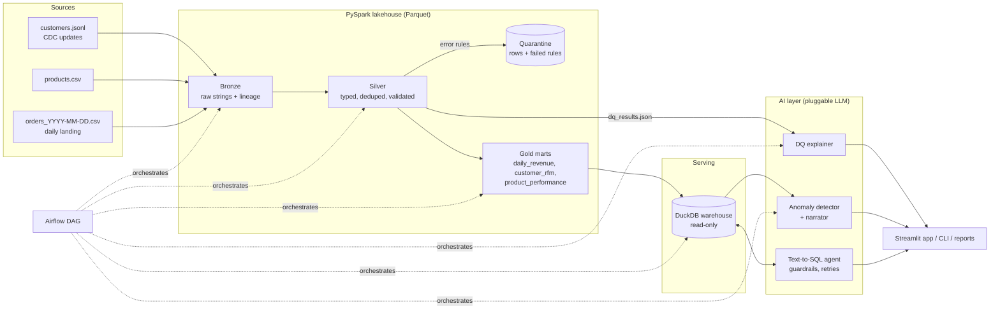

# 🌊 LakeSense AI

**An AI-augmented PySpark lakehouse.** A medallion pipeline (bronze → silver → gold) that
validates its own data, quarantines bad records with reasons, detects business anomalies,
and uses an LLM to **explain data-quality incidents**, **narrate anomalies** and answer
**plain-English questions with guarded text-to-SQL**.

[](https://github.com/arjunmylagondawork-dev/lakesense-ai/actions/workflows/ci.yml)


> 📖 **Visual walkthrough:** [docs/how-it-works.html](docs/how-it-works.html) is an interactive page covering the
> pipeline stages, the journey of real bad records, anomaly results and a SQL guardrail playground.
> To view it live, enable GitHub Pages (Settings → Pages → `main` / `docs`) or open the file in a browser.

> Runs fully offline in about 2 minutes: no cloud account and no API key needed (a deterministic
> mock LLM is built in). Plug in OpenAI, Anthropic or Amazon Bedrock with one environment variable.

---

## Why this project

Most "AI + data" demos skip the hard part: **the data is messy**. LakeSense starts from
deliberately dirty source files (nulls, negative quantities, broken timestamps, orphan keys,
duplicates, text in numeric columns) and shows how a production-style pipeline handles them.
Then it applies AI where it actually helps a data team:

| Problem a data team has | What LakeSense does |
|---|---|
| "Why did 1,800 rows get rejected last night?" | Config-driven DQ engine + **LLM incident report** with root cause, impact and fix snippets |
| "Revenue looks weird on Tuesday" | **Robust statistical anomaly detection** (weekday-adjusted median/MAD z-score) + LLM narrative |
| "Can you pull top customers by country for me?" | **Text-to-SQL agent** with SQL guardrails, read-only execution, self-correction and audit log |

## Architecture



## Data-engineering highlights

- **Medallion architecture**: bronze is a schema-on-read, replayable copy with lineage columns
  (`_source_file`, `_ingest_ts`, `_batch_id`); silver is typed and clean; gold is business-ready.
- **ANSI-safe parsing**: `try_cast` / `try_to_timestamp` turn bad values into NULL instead of
  crashing the job. Two timestamp formats (ISO and a legacy `dd/MM/yyyy HH:mm`) are supported.
- **Config-driven data quality** (`config/pipeline.yaml`): `not_null`, `range`, `accepted_values`,
  `regex`, `not_future`, `referential`. All rules are evaluated in **one pass** into an array of
  failed rule names, so quarantined rows always say *why* they were rejected. `error` rules block a row; `warn` rules only report it.
- **Referential integrity with broadcast joins**, dimensions loaded before facts, and visible
  cascading failures (a quarantined product orphans its order lines).
- **Window functions everywhere**: `row_number` dedup (latest record wins), 7-day moving average,
  `ntile` RFM scoring, `dense_rank` in-category ranking, revenue share by partition.
- **Partitioned Parquet** (`order_date`), dynamic partition overwrite, AQE enabled.
- **Atomic warehouse publish**: built to a temp file and swapped in, so readers never see half a warehouse.
- **Orchestration**: Airflow DAG with retries and exponential backoff; every task calls the same CLI.
- **Tested**: 40+ pytest tests (every cleaning function, every gold mart and every rule type, a guardrail
  security suite, the AI retry paths, and a full end-to-end run), plus ruff lint and GitHub Actions CI.

## AI highlights

- **Provider-agnostic LLM client**: `mock | openai | anthropic | bedrock` (Bedrock uses the Converse API).
  SDKs are optional, lazily imported dependencies.
- **LLM output is treated as untrusted input.** Generated SQL is parsed with `sqlglot` and must be a
  single `SELECT`; DDL/DML, `ATTACH`, `COPY`, `PRAGMA`, file-reading functions and non-whitelisted
  tables and schema-qualified names (`other_db.main.x`) are rejected; any `LIMIT` that is not a plain
  integer (`LIMIT 5+1000000`, `LIMIT 100 PERCENT`) is replaced. Execution uses a **read-only** DuckDB
  connection with **file and network access disabled**, so even SQL that slipped past the parser can't read files.
- **Self-correction loop**: malformed SQL and database errors are fed back to the model (up to N retries).
  Unsafe SQL is *never* retried; it fails closed. Questions the tables can't answer get a clear
  "can't answer" instead of a made-up query.
- **Statistics detect, the LLM explains**: anomalies are found with a weekday-adjusted robust z-score
  (no hallucinated alerts); the LLM only writes the explanation, using a per-category breakdown as grounding.
- **Auditability**: every question, generated SQL, outcome, attempt count and latency is logged to
  `reports/query_log.jsonl`.

## Quick start

Requirements: Python 3.10+ and Java 17+ (for Spark).

```bash
git clone https://github.com/arjunmylagondawork-dev/lakesense-ai.git
cd lakesense-ai
python -m venv .venv && source .venv/bin/activate
pip install -e ".[app,dev]"

lakesense all                             # generate data, run every layer, write AI reports
                                          # (run from the project folder, or set LAKESENSE_HOME)
lakesense ask "top 5 customers by spend"  # natural language -> SQL -> answer
streamlit run app/streamlit_app.py        # dashboard at http://localhost:8501
pytest                                    # run the test suite
```

Or with Docker: `docker compose up --build`, then open http://localhost:8501.

### Use a real LLM

```bash
pip install -e ".[openai]"      # or .[anthropic] / .[bedrock]
cp .env.example .env            # set LAKESENSE_LLM_PROVIDER=openai and OPENAI_API_KEY=...
lakesense dq-report             # .env is loaded automatically (real env vars take priority)
```

## Example output

```text
$ lakesense ask "top 5 customers by spend"

SQL (1 attempt(s), 83 ms):
SELECT customer_id, name, country, frequency, monetary, rfm_segment
FROM customer_rfm ORDER BY monetary DESC LIMIT 5

customer_id            name country  frequency  monetary rfm_segment
     C01305       Kabir Rao      SG         15  23518.79    champion
     C01244     Rohan Patel      IN         22  21792.88    champion
     ...
```

Sample reports from a real run are in [`reports/sample/`](reports/sample/):
[DQ incident report](reports/sample/dq_report.md) and [anomaly report](reports/sample/anomaly_report.md).
The generator injects a revenue spike on 2026-07-16 and an outage-style drop on 2026-08-28; both are detected.

## Project structure

```
lakesense-ai/
├── config/pipeline.yaml          # paths, generator, DQ rules, anomaly + text-to-SQL settings
├── src/lakesense/
│   ├── generator/                # seeded synthetic dirty data
│   ├── pipeline/                 # bronze.py, silver.py, gold.py
│   ├── quality/rules.py          # config-driven DQ engine
│   ├── serving/warehouse.py      # DuckDB publish + schema introspection
│   ├── ai/                       # llm.py, prompts.py, dq_explainer.py, anomaly.py,
│   │                             # text_to_sql.py, sql_guardrails.py, mock_responses.py
│   └── cli.py                    # `lakesense` command
├── app/streamlit_app.py          # dashboard + "Ask your data"
├── dags/lakesense_dag.py         # Airflow orchestration
├── tests/                        # unit, security and end-to-end tests
├── docs/                         # architecture decisions and roadmap
├── Dockerfile, docker-compose.yml, Makefile
└── .github/workflows/ci.yml
```

## CLI

| Command | What it does |
|---|---|
| `lakesense generate` | Write synthetic raw files to `data/raw/` |
| `lakesense run --layer bronze\|silver\|gold\|publish\|all` | Run pipeline layers |
| `lakesense dq-report` | AI data-quality incident report → `reports/dq_report.md` |
| `lakesense anomalies` | Anomaly detection + narrative → `reports/anomaly_report.md` |
| `lakesense ask "<question>"` | Guarded text-to-SQL |
| `lakesense all` | Everything, end to end |

## Design decisions

See [docs/ARCHITECTURE.md](docs/ARCHITECTURE.md). In short: Parquet + DuckDB keep the project free and
cloneable; each piece maps one-to-one to AWS (S3 + Glue/EMR + Athena/Redshift + MWAA + Bedrock).

## Roadmap

See [docs/ROADMAP.md](docs/ROADMAP.md): Delta/Iceberg tables, incremental loads, dbt models,
Kafka streaming, Terraform for AWS deployment, an evaluation set for text-to-SQL, and RAG over a data catalog.

## Notes

The dataset is synthetic and generated locally, so no real customer data is used. The default `mock` LLM
returns deterministic, template-based answers so that the full AI flow (prompting, guardrails, retries,
reporting) runs and is tested without an API key. Switch providers for genuine model output.

## License

MIT © Arjun Mylagonda
